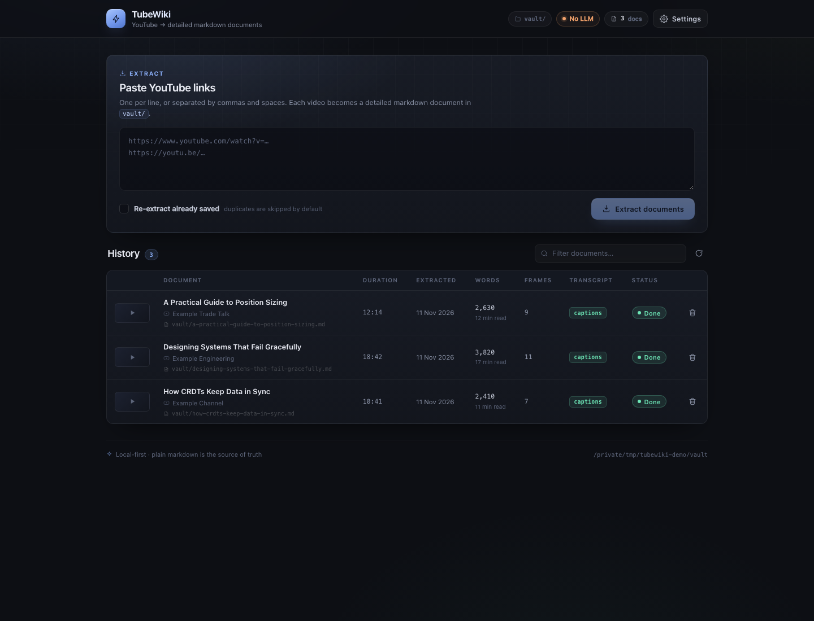

# TubeWiki — YouTube → detailed markdown documents

Paste one or more YouTube links and get a **structured, illustrated markdown
document** written into a folder you own. No categories, no browser, no search —
just extraction. (A document browser can be added later; the output is plain
markdown, so Obsidian/any editor works today.)

```
YouTube links ──▶ extractor ──▶ vault/
                                 ├── <video-title>.md
                                 ├── assets/<video_id>/<timestamp>.jpg
                                 └── .tubewiki/tubewiki.db   (derived metadata)
```



## Quick start

Fresh clone:

```bash
git clone https://github.com/godlesscherry/tubewiki.git
cd tubewiki
uv venv --python 3.12 .venv
uv pip install -r backend/requirements.txt
(cd frontend && npm install)
./tubewiki open          # builds the UI if needed, serves http://127.0.0.1:8787
```

Already set up:

```bash
cd ~/Playground/tubewiki
./tubewiki open
```

> `vault/` is git-ignored on purpose: it holds your personal documents and
> extracted frames. The folder itself (`.gitkeep`) is tracked so the app has
> somewhere to write after a clone.

Paste up to 10 YouTube URLs, press **Extract documents**, then open
`vault/` — one markdown file per video with an overview, chapters, inline
slide frames, quotes and takeaways.

Configure everything from the **Settings** page in the header:

- **LLM** — API key, base URL, model, vision model, document mode
  (`auto` / `extractive` / `llm`), with a **Test connection** button.
- **Output** — the folder where documents and images are written (created if
  missing; defaults to `vault/`).

Settings are stored locally in `settings.json` (git-ignored, mode `0600`, the raw
key is never returned by the API) and applied immediately.

Works with OpenAI or any OpenAI-compatible server. For local Ollama:

```
Base URL: http://localhost:11434/v1
Model:    llama3.1:8b
API key:  ollama            (any non-empty string)
```

> `.env` / environment variables still work; `settings.json` wins when present.

## Commands

| Command | What it does |
| --- | --- |
| `./tubewiki open` | Build UI if needed + serve app at `http://127.0.0.1:8787` |
| `./tubewiki api` | Backend only, reload mode (`:8787`) |
| `./tubewiki dev` | Backend + Vite dev server (`:5173`) |
| `./tubewiki build` | Build the React UI into `frontend/dist` |
| `./tubewiki status` | Hit `/api/health` |

## What a document contains

`vault/<slug>.md`:

- YAML frontmatter: title, source URL, video id, channel, published/extracted
  dates, transcript source, frame count, `document` mode, `words`, `reading_minutes`
- TL;DR (3 bullets) and a prose **Overview**
- **In this document** contents with timestamps
- Timestamped **chapters** written as paragraphs, with captured slide/diagram
  frames inlined, pull quotes and highlights
- **Key takeaways** and the full **transcript** appendix

Two document modes, selected with `TUBEWIKI_DOC_MODE=auto|extractive|llm`:
offline extractive (default, no key) or LLM-written sections.

## Stack

| Layer | Choice | Why |
| --- | --- | --- |
| API | **FastAPI + Pydantic v2 + Uvicorn** (Python 3.12) | async background jobs, typed contracts |
| Metadata | **SQLite (WAL)** | videos + jobs only; derived, deletable |
| Content | **Markdown + frontmatter** in `vault/` (configurable) | source of truth, readable, git-able |
| Settings | **settings.json** (git-ignored, 0600) | local-first config, applied live |
| Extraction | **yt-dlp** (metadata/captions), **ffmpeg** (scene frames), **Pillow** (aHash dedupe) | local, free, battle-tested |
| LLM (optional) | any **OpenAI-compatible** endpoint via httpx | document rewrite + vision captions |
| UI | **React 19 + TypeScript + Vite**, hand-rolled CSS | minimal single-page dashboard |

## API

11 endpoints, all under `/api`:

- `POST /api/ingest` `{urls[], force?}` → `{job_id, accepted, duplicates, rejected}`
- `GET /api/jobs`, `GET /api/jobs/{id}`
- `GET /api/sources?q=&status=`, `GET /api/sources/check?url=`,
  `DELETE /api/sources/{video_id}`
- `GET /api/config`, `GET /api/health`
- `GET /api/settings`, `PUT /api/settings`, `POST /api/settings/test-llm`

OpenAPI docs at `http://127.0.0.1:8787/docs`; full contract in
[`docs/API.md`](docs/API.md).

## Layout

```
tubewiki/
├── tubewiki                 # launcher
├── backend/app/          # FastAPI: db, schemas, llm, routers/, ingest/
├── frontend/             # React + Vite UI
├── vault/           # generated documents + images  ← backup this
├── docs/API.md
└── .env.example
```

The SQLite DB is derived from the markdown files; delete `vault/.tubewiki/` and
start the server again to rebuild it.

## Notes

- Duplicate links are skipped unless you tick **Re-extract already saved**.
- Deleting a source removes its metadata row only; the markdown file is left on
  disk (the documents are yours).
- Use `q` on the History view to filter the list — it is table filtering, not a
  document search feature.
- Changing the output directory only redirects future extractions; your history
  stays in the app-level database, and existing documents stay where they are.

## Roadmap

- Whisper fallback for videos without captions.
- Web/article + PDF connectors writing into the same folder.
- A read-only document browser (the reason we kept the output as plain markdown).
